<a href="https://soumilbhandari.com">
  
</a>

<p align="center">
  <a href="https://soumilbhandari.com"></a>
  <a href="https://www.linkedin.com/in/soumilbhandari"></a>
  <a href="https://x.com/SoumilBhandari"></a>
  <a href="mailto:soumil.bhandari@gmail.com"></a>
  
</p>

## `01` whoami

I build ML models and physical AI for medicine: diffusion language models trained from scratch, benchmarks that check whether AI safety tools actually work, and wearables that watch the brain. I study Computer Engineering at **Purdue** and research dendritic model compression at **Perforated AI**. Before that I did research at **Harvard Medical School** and **IIT Roorkee** and wrote software at **McKesson** and **Tekizma**.

My rule for anything I ship is to find out honestly whether it works, even when the answer is no.

```python
class Soumil:
    def __init__(self):
        self.studying   = "B.S. Computer Engineering @ Purdue"
        self.working_on = "dendritic model compression @ Perforated AI"
        self.previously = ["Harvard Medical School", "McKesson", "IIT Roorkee", "Tekizma"]
        self.obsessions = ["diffusion LMs", "AI security", "neurotech", "medical hardware"]
        self.patents    = 3            # provisional, multimodal neurodegenerative modeling
        self.off_screen = ["basketball", "working out", "ice cream sundaes"]

    def ask_me_about(self):
        return ["why masked diffusion LMs are underrated",
                "why most backdoor detectors score below chance",
                "building hardware that fits on a head"]
```


## `02` selected work

<p align="center">
  <a href="https://github.com/SoumilBhandari/nanoDLM">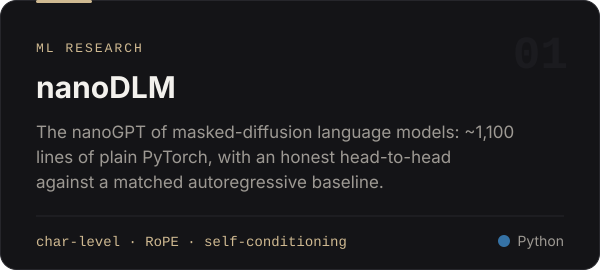</a>
  <a href="https://github.com/SoumilBhandari/deadbolt">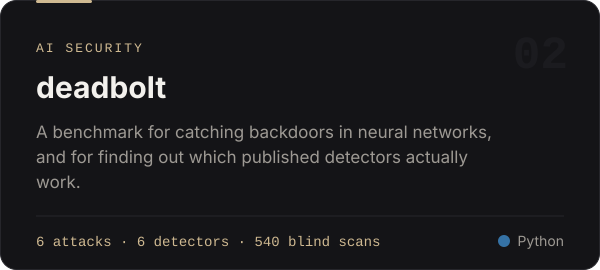</a>
  <a href="https://github.com/SoumilBhandari/Bastion">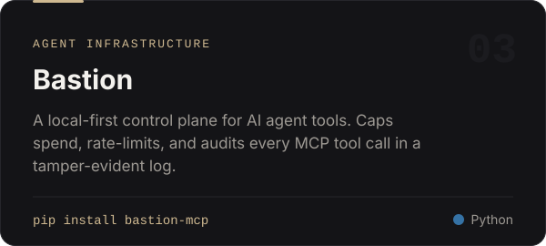</a>
  <a href="https://github.com/SoumilBhandari/halluscope">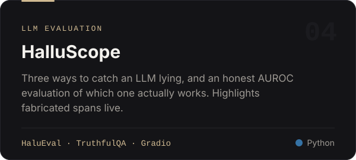</a>
  <a href="https://github.com/SoumilBhandari/SecuriVax">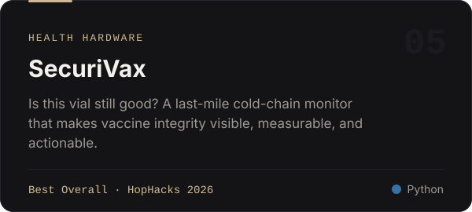</a>
  <a href="https://github.com/SoumilBhandari/NeuraBand">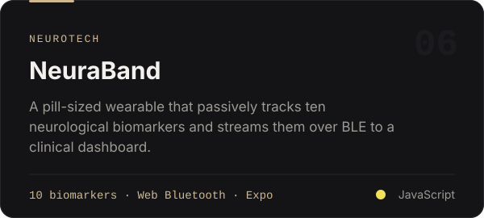</a>
  <a href="https://github.com/SoumilBhandari/ATLAS">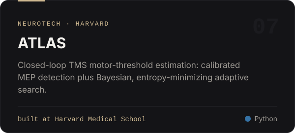</a>
  <a href="https://github.com/SoumilBhandari/you2">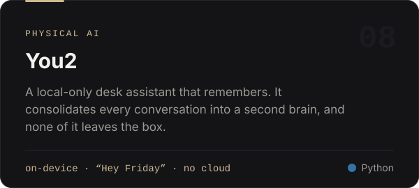</a>
</p>

<details>
<summary><b>More builds</b></summary>
<br>

| Project | What it is |
|:--|:--|
| [**Neural Space Cap**](https://github.com/SoumilBhandari/Neural-Space-Cap-Hardware) | A 3D-printed EEG cap generated from a LiDAR scan of one specific head, worn under an EVA helmet. Purdue VIP / AAMED. ([software](https://github.com/SoumilBhandari/Neural-Space-Cap-Software)) |
| [**ChatDLM**](https://github.com/SoumilBhandari/ChatDLM) | An MDLM-style masked diffusion LM targeting ~400M parameters on a single RTX 3090. |
| [**Fleet Simulation Engine**](https://github.com/SoumilBhandari/saronic-takehome) | A discrete-time vessel fleet simulator with cargo, docks, and historical queries. Standard library only. |
| [**SimplrAI**](https://github.com/SoumilBhandari/Senior-Project-Research-Paper) | Senior capstone research: designing and evaluating a grade-appropriate AI explanation system. [simplrai.tech](https://simplrai.tech) |
| [**Rhetorify**](https://github.com/SoumilBhandari/Rhetorify) | Turns a Word doc of debate evidence into a navigable stack of cards. |
| **Notes360.ai** | AI note-taking, grown to 1,000+ students across five schools. |
| **Flipper** | A real-estate deal-sourcing engine: 500+ properties surfaced, $1.2M+ in identified spread. |

</details>

## `03` path


## `04` toolkit

<p align="center">
  <b>ML & research</b><br><br>
  <br>
  
  
  
  
  
</p>

<p align="center">
  <b>Systems & hardware</b><br><br>
  
</p>

<p align="center">
  <b>Web & product</b><br><br>
  
</p>

## `05` activity

<p align="center">
  
  
</p>

<sub>These cards are rebuilt every day by a <a href=".github/workflows/stats.yml">GitHub Action</a>, so they never go down with a third-party stats service.</sub>

## `06` recognition

- 🏆 **Best Overall Hack**, HopHacks Fall 2026, for [SecuriVax](https://github.com/SoumilBhandari/SecuriVax)
- 🚀 **Y Combinator Startup School**, selected from 35,000+ applicants (top 4%)
- 🔬 **Virginia State Science Fair**, recognized by Leidos, Yale Science & Engineering, and the Office of Naval Research
- 💼 **Distinguished Intern Award**, Tekizma, the only intern recognized multiple consecutive years
- 📜 **Three provisional US patents** in multimodal neurodegenerative modeling

<details>
<summary><b>Debate</b></summary>
<br>

| Year | Tournament | Result |
|:--|:--|:--|
| 2025 | Columbia Invitational | **Champion**, 11–1 · gold bid to the TOC |
| 2025 | WACFL Public Forum 5 | **Champion**, 4–0 · undefeated at the largest regional to date |
| 2025 | WACFL Public Forum 4 | **Champion**, 4–0 |
| 2025 | Sunvite | Octofinalist, 5–1 · bid to the TOC |
| 2024 | George Mason University | Quarterfinalist, first seed · gold bid to the TOC |
| 2024 | Coolidge Qualifier | Quarterfinalist, first seed · bid to the TOC |

</details>

## `07` say hi

I'm always up for talking about diffusion models, AI security, neurotech, or anything you're building. The fastest way to reach me is [**email**](mailto:soumil.bhandari@gmail.com), and my resume is a request away at [soumilbhandari.com/resume](https://soumilbhandari.com/resume).


