<a href="https://soumilbhandari.com">
  
</a>

<p align="center">
  <a href="https://soumilbhandari.com"></a>
  <a href="https://www.linkedin.com/in/soumilbhandari"></a>
  <a href="https://x.com/SoumilBhandari"></a>
  <a href="mailto:soumil.bhandari@gmail.com"></a>
  
</p>

## whoami

i do ai research and build state of the art ml models.

```python
class Soumil:
    school = "purdue, compE '28"
    now    = ["ai research @ perforated ai", "electronics @ purdue fsae"]
    into   = ["ai", "defense tech", "national security", "neurotech"]
    off    = ["hoops", "lifting", "ice cream sundaes"]
    site   = "soumilbhandari.com"  # start with the lamp
```

<details>
<summary><b>the resume version</b></summary>
<br>



**some wins**

- 1st of 280+ at HopHacks 2026, for [SecuriVax](https://github.com/SoumilBhandari/SecuriVax)
- YC AI Startup School (2,500 picked from 35,000+)
- Virginia State Science Fair: Office of Naval Research, Yale, and Leidos awards
- Columbia Invitational debate champ

**patents** · 3 provisionals, filed dec 2025

- *Modality-Balanced Multi-Omic Modeling with Drift-Resilient Harmonization* (63/949,237)
- *Tri-Modal Network-Based Identification of Neurobiological Resilience Signatures* (63/949,231)
- *Quantifying and Predicting Cognitive Resilience Under Neurodegenerative and Stress-Induced Pathologies* (63/949,240)

</details>

