<a href="https://soumilbhandari.com">
  
</a>

<p align="center">
  <a href="https://soumilbhandari.com"></a>
  <a href="https://www.linkedin.com/in/soumilbhandari"></a>
  <a href="https://x.com/SoumilBhandari"></a>
  <a href="mailto:soumil.bhandari@gmail.com"></a>
  
</p>

## `01` whoami

I build ML models and hardware for medicine, then find out honestly whether they work. Purdue CompE ’28, AI research at **Perforated AI**, electronics on **Purdue Formula SAE**. Previously **Harvard Medical School**, **McKesson**, and **IIT Roorkee**.

```python
class Soumil:
    def __init__(self):
        self.studying   = "B.S. Computer Engineering @ Purdue, class of 2028"
        self.working_on = ["dendritic model compression @ Perforated AI",
                           "telemetry electronics @ Purdue Formula SAE"]
        self.previously = ["Harvard Medical School", "McKesson", "IIT Roorkee"]
        self.obsessions = ["diffusion LMs", "AI security", "neurotech", "medical hardware"]
        self.patents    = 3            # provisional, multimodal neurodegenerative modeling
        self.startups   = {"Neurafy": "failed. learned the most from this one"}
        self.off_screen = ["basketball", "working out", "ice cream sundaes"]
        self.website    = "soumilbhandari.com"   # start with the lamp

    def ask_me_about(self):
        return ["why masked diffusion LMs are underrated",
                "why most backdoor detectors score below chance",
                "building hardware that fits on a head"]
```


## `02` builds

<a href="https://github.com/SoumilBhandari?tab=repositories"></a>

## `03` things i found out



## `04` stack

<p align="center">
  <b>ML & research</b><br><br>
  <br>
  
  
  
  
  
  
  
  
</p>

<p align="center">
  <b>Systems & hardware</b><br><br>
  <br>
  
  
  
</p>

<p align="center">
  <b>Web & product</b><br><br>
  
</p>


<details>
<summary><b>The long version</b></summary>
<br>


**Recognition**

- **1st Overall of 280+**, HopHacks 2026, for [SecuriVax](https://github.com/SoumilBhandari/SecuriVax)
- **Y Combinator AI Startup School**, 2,500 selected of 35,000+ applicants (top 4%)
- **Virginia State Science & Engineering Fair**: Office of Naval Research, Yale Science & Engineering Association, and Leidos awards, from a ~200-exhibit state field
- **Columbia Invitational debate champion**, 11–1, gold bid to the TOC

**Patents** · named inventor, filed Dec 2025

- *Modality-Balanced Multi-Omic Modeling with Drift-Resilient Harmonization* (63/949,237)
- *Tri-Modal Network-Based Identification of Neurobiological Resilience Signatures* (63/949,231)
- *Quantifying and Predicting Cognitive Resilience Under Neurodegenerative and Stress-Induced Pathologies* (63/949,240)

</details>

